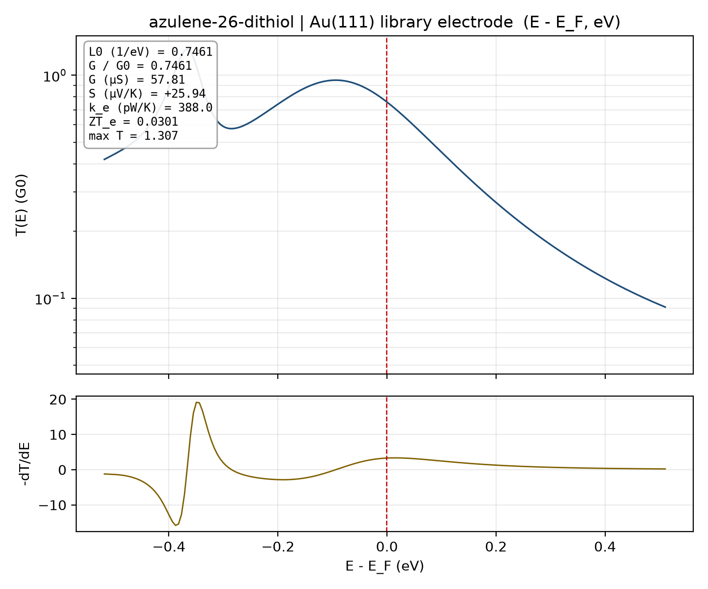

# 薁（2,6-二巯基薁）单分子结 SMJ 测试 demo

本目录用 AutoSMJ **0.1.2** 的七阶段链（含 `electrodes.library` 库电极与 `au_relax` 背层
固定弛豫）真实跑通一个 2,6-二巯基薁 / Au(111) 单分子结，作为端到端测试样例。计算在
`gpu-outside`（gpu1，partition `main`）上完成，300 K。

## 1. 体系与输入

| 项 | 值 |
|---|---|
| 分子 | 2,6-二巯基薁（dithiol），中性 20 原子，Gaussian B3LYP/def2-TZVP opt+freq，0 虚频，E = −1182.42130005 Ha |
| 来源 | 主仓 `AgenticDFT/work/azulene-dithiol-reopt/opt.xyz`（`molecule.xyz` 即其拷贝） |
| 电极 | FHI-aims `electrodes.library` → `fcc111.au.clusters.37_atoms/natoms37.x1.aims`（37 原子/侧，含 tip；sha256 `8e676297c47c…`，头部建议 `nlayers=3`） |
| 结几何 | 92 原子 = 18（去 S–H） + 2 Au tip + 72 库原子 |
| species | `species/` 四个文件（01_H/06_C/16_S/79_Au），本地内联进 `control.in` |
| 电子结构 | FHI-aims PBE，`KS_method serial`（aitranss 只认 serial 的 `omat.aims`） |
| 输运窗 | `[-0.2075, 0.0002, -0.1695]` **Ha 绝对能量**（E_F≈−0.18845 Ha，即 E−E_F ∈ [−0.52, +0.52] eV，193 点） |

> 注：`transport.energy_window` 的单位是 Hartree 绝对能量，不是 eV；这是本次 demo 踩到
> 的第一个坑（见 §5）。

## 2. 复现步骤

```bash
# 1) gaussian_opt：复用主仓已完成的优化（seed_gaussian.py 把 mol.log 落成 collected）
../../.venv/Scripts/python.exe seed_gaussian.py smj.yaml

# 2) tip 弛豫（20 原子，8 rank / 8G；16 rank 会 OOM）
../../.venv/Scripts/smj.cmd stage aims_tip_relax --run -c smj.yaml

# 3) 库电极建结（92 原子）
../../.venv/Scripts/smj.cmd stage au60_build --run -c smj.yaml

# 4) A2 表面确认（审计 + 出图；审计不过/无图会拒绝，退出码 2）
../../.venv/Scripts/smj.cmd review --approve --who "<签署人>" -c smj.yaml

# 5) 背层固定弛豫（Au 全冻结，只让分子弛豫；71 min）
../../.venv/Scripts/smj.cmd stage au_relax --run -c smj.yaml

# 6) SCF → TE → Landauer 分析
../../.venv/Scripts/smj.cmd stage aims_scf --run -c smj.yaml
../../.venv/Scripts/smj.cmd stage aitranss_te --run -c smj.yaml
../../.venv/Scripts/smj.cmd stage junction_analyze --run -c smj.yaml

# 7) 报告 + 图
../../.venv/Scripts/smj.cmd report --force -c smj.yaml
../../.venv/Scripts/python.exe plot_results.py azulene-26-dithiol
```

本目录保留了关键产物（`state.json`、`TE.dat`、`results.json`、`report.md`、`TE_overview.png`、
各阶段 `geometry.in` 与 `electrode_metadata.json`），`aims.out`/`slurm-*.out`/`mos.aims` 等
大文件不入库。

## 3. 结果

| 量 | 值 |
|---|---|
| T(E_F) | 0.746 |
| G | 0.746 G0 = **57.8 µS** |
| Seebeck S | **+25.94 µV/K** |
| k_e | 388.0 pW/K |
| ZT_e | 0.0301 |
| 主透射峰 | T=1.30 @ E−E_F = −0.37 eV；次峰 T=0.95 @ −0.06 eV |
| 判定 | 工程判定 **通过**；物理判定 **inconclusive**（唯一未过：`t_ef_no_peak_near_ef` warn） |



与主仓此前 138 原子（60 Au/侧、nlayers 4、Au–S 2.24 Å）基线的对照：

| 量 | 本次 demo（92 原子，库电极 37/侧，nlayers 3，Au–S 2.56 Å） | 主仓 138 原子基线 |
|---|---|---|
| T(E_F) | 0.746 | 0.762 |
| G (µS) | 57.8 | 55.5 |
| S (µV/K) | +25.9 | +39.6 |
| k_e (pW/K) | 388 | 298 |
| ZT_e | 0.030 | 0.087 |

电导与基线一致到 4%，Seebeck 差约 35%——两者电极尺寸/层数/接触距离都不同，且 S 对
E_F 附近透射斜率极敏感（步长 5.4 meV），这个量级差异属预期。

## 4. 各阶段真实开销

| 阶段 | 作业 | 资源 | 墙钟 |
|---|---|---|---|
| aims_tip_relax | 26020 | 8 rank / 8G | 3 min |
| au_relax | 26029 | 8 rank / 9G | 71 min（15 个 SCF，末步最大力 0.028 eV/Å） |
| aims_scf | 26033 | 4 rank / 9G | 38 min（90 次迭代收敛，E_F = −5.127 eV） |
| aitranss_te | 26035 | 1 核 | 4 min（193 点） |

节点当时被 4 个 `adft-*` 作业各占 28G（合计 112G），本 demo 只能拿到 ~9.7G；8 rank 的
aims_scf 会 OOM，降到 4 rank 才通过。

## 5. demo 暴露并已修的问题

1. **slurm-ssh 下 `prepare` 不建传输层** → `au60_build` 走库电极时永远看不到远端
   `electrodes.library`（报"未找到库"）。修：`Runner.prepare` 在 `stage.prepare` 前
   `_ensure_transport()`。（commit `495d409`）
2. **本地阶段 `collect` 仍去远端回取** → `au60_build --collect` 报"未知 smj 阶段"
   （artifacts 台账里没有本地阶段）。修：`needs_submit=False` 的阶段跳过下载。（`495d409`）
3. **backplane 冻结不够用**：理想晶格 Au 参与 BFGS 后最大力在 0.4–0.9 eV/Å 之间震荡。
   新增 `electrode.relax_freeze: electrodes`（冻结全部 Au，只让分子弛豫），力序列
   0.93 → 0.03，71 min 收敛。（`a3fb891`）
4. **表面三元组校验误杀**：S 放开后 S 会扭到 Au 上方（Au–S 2.40→2.56 Å），
   `tip→linker` 轴偏转 28°，det-v1 重算退化报"表面三角无法构造"。改为：先验三元组
   仍是同元素非共线三角；表面原子坐标未动即通过，只有确实移动才重算。（`25bda2f`）
5. **`energy_window` 单位文档错误**：README/config 模板写 "(eV)"，但 `tcontrol` 直接写
   `$ener/$estep/$eend`，aitranss 按 **Hartree** 解释。按 eV 填 ±1.0 会得到 ±27 eV 的
   扫描，E_F 处只有 1 个采样点、Landauer 积分完全失真（第一次分析 L0=7.4e-4、
   S=−594 µV/K）。已改文档并给出 Ha 示例。
6. **判据族无法从 CLI 指定**：criteria 里已登记 `AZ = Au-(2,6-azulenedithiol)-Au`，
   但没人把 system 传进去，导致 BDT 绿带给薁作闸门、判 failed。新增
   `molecule.family: AZ`，判定变为"不适用"。（本 commit）

## 6. T(E) 为什么会大于 1

见 `TE_overview.png`：−0.37 eV 处主峰 T=1.30。它不是"传输概率大于 100%"，而是电极模型
的产物，拆开说有三层。

**第一层：定义上 T(E) 本来就不以 1 为界。** aitranss 输出的是 `T(E) per spin`，等于该
能量下所有输运通道透射本征值之和 `T(E) = Σ_i τ_i(E)`；单通道 τ_i ≤ 1，但多通道之和可以
大于 1，上界是该能量下引线的通道数 M(E) 而不是 1。T=1.30 读作"至少两个通道同时部分导通"
（例如 1.0 + 0.3）。

**第二层：本例的"引线"不是半无限周期电极。** `te.out` 里可以看到它的实际做法：

```
coulping region range=  3 atomic layers
i(sigma) 1st layer = 0.100000000000 H
i(sigma) 2nd layer = 0.050000000000 H
i(sigma) 3rd layer = 0.025000000000 H
```

即 Arnold–Evers 的复吸收势（CAP）图像：只在外侧 3 层 Au 上加虚数自能来吸收出射波，电极
是有限团簇而不是真正接上块体。有限吸收层 + 有限团簇的散射解不严格幺正，在团簇离散能级
处形成的共振可以把 T 推到 1 以上；37 原子团簇的能级稀疏，这种共振比 138 原子基线更强。

**第三层：实测排除了"层数不够"这个最直觉的解释。** 把 `electrode.nlayers` 从 3 改成 4
重跑 aitranss（作业 26036），产物 `TE.dat` 与 3 层版本**逐字节相同**
（sha256 `01D89887…`），`te.out` 仍写 3 层——这个参数在 37 原子团簇上不改变吸收区。
作为反证，主仓同一分子在 138 原子（60 Au/侧、nlayers 4）基线的 ±1.63 eV 全窗口 1200 点里
**没有任何点 T>1**（Tmax=0.991 @ −0.048 eV，而 −0.37 eV 处只有 T=0.15）。所以 >1 是
"小团簇 + CAP"造成的强共振，不是这个分子结的物理特征。

**对结论的影响：可以忽略。** Seebeck 只对 E_F 附近 ±k_BT（300 K 时约 26 meV）的透射斜率
敏感，−0.37 eV 的峰对 dlnT/dE 的贡献按 e^(−0.37/0.026) 量级衰减；T(E_F)=0.762 也在
基线 0.7619 上复现。真正要警惕的是把 −0.4 eV 附近的峰当成"真实多通道"去解读——它更
接近电极模型误差。

## 7. 已知限制

- 观测到的 Au–S 平衡距离 2.56 Å，与主仓基线的 2.24 Å 不同：本 demo 只冻 Au、让 S 自由
  弛豫到稳定位置；2.24 Å 是"tip_relax 把 S 钉在 2.40 Å"那条路径的产物。哪条更接近真实
  Au(111)–thiolate 接触（实验 2.4–2.5 Å）值得单独评估。
- 37 原子库团簇比主仓 60/侧的自建电极小：透射谱细节（峰位、峰高、T>1 的共振）会有差异；
  `nlayers` 在这套团簇上实测不改变结果（见 §6），所以不能靠调它来"修"峰高。电导一致到
  4% 属巧合级别的吻合，不能当收敛性证据。
- `t_ef_no_peak_near_ef` warn：E_F 恰好落在两个峰的谷底附近（−0.06 eV 峰肩），判据要求
  近旁有显著峰；这是判据对"谷底输运"体系的保守设定，不是数值错误。
- gaussian_opt 是**复用**主仓已有优化（seed 脚本落盘），本 demo 没有在本机重跑 Gaussian。
