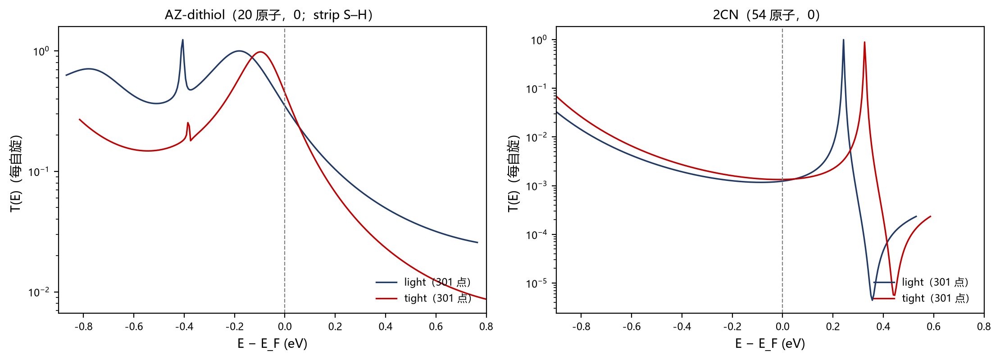

# light vs tight 整链输运对照（2026-11-22）

> 目的：在同一分子、同一生产协议、同一能量窗下，只改变 FHI-aims species 档位（light / tight），
> 把“分子优化 → tip 弛豫 → 建结 → SCF → Aitranss → 分析”整条链跑通，给出透射谱与热电器件的
> 定量差异。此前的 compare-2026-11-15 只完成了 molecule_opt，不能回答 tight 档对输运的影响。

## 1. 设计

| 项目 | 设置 |
|---|---|
| 体系 | AZ-dithiol（azulene-2,6-dithiol，C10H8S2，20 原子，charge 0，tip 阶段 strip S–H）；2CN（2CN-656-4-thiomethylphenyl，54 原子，charge 0） |
| 唯一变量 | species 档位：light（demo 的 2020 light）vs tight（defaults_2020/tight） |
| 电子结构 | FHI-aims 221103，PBE，spin none，vdW TS（hirshfeld），atomic_zora scalar |
| 分子优化 | BFGS，最大力 1e-2 eV/Å，sc_accuracy_forces 5e-3 eV/Å，sc_iter_limit 1000 |
| tip 弛豫 | Au–S 初距 2.35 Å，pin_contact=false，全原子 BFGS |
| 电极 | fcc111 37 Au/侧，nlayers=3，冻结 |
| SCF | rho 1e-5，eev 1e-3，etot 1e-6，sc_iter_limit 500，KS_method serial |
| 输运 | Aitranss 071813，σ=0.05/0.10 Ha，能量窗 [−0.22, 0.0002, −0.16] Ha（301 点），T=300 K |
| 调度 | gpu-outside，CPU 8 任务/臂（aims_gpus=cpu） |

四臂互相独立：`runs/light-tight-2026-11-22/<arm>/lt-<arm>/`。注意：每档的分子与 tip 几何都在该档下重新优化，
因此下面的输运差异包含几何响应，不是“同一几何只换基组”的单点对照。

另有两条 `az-thiolate-*` 臂在 tip/SCF 阶段 SCF 不收敛，已移入
`runs/light-tight-2026-11-22/_abandoned/`，不属于四臂对照数据（原因见下）。

> **为什么 AZ 用中性二硫醇而不是 az-thiolate(−2)**：最初沿用 compare-2026-11-15 的
> 游离二价阴离子构造（18 原子，charge −2）再叠加中性 Au tip。该构造在 tip 阶段的 SCF
> 在 500 次迭代内没有收敛（Δρ 在 0.1–0.8 之间振荡，日志反复出现 “VBM is higher than
> the internal energy zero”），无法进入建结。更重要的是它不属于生产接触模型：生产链对
> 硫醇走 `strip_thiol_h`，去掉 S–H 后由 Au–S 成键，整胞保持中性（见 0.2.0 的 AZ 算例，
> charge 0、18 原子分子 + 74 Au）。因此 AZ 改用中性 C10H8S2（20 原子）+ tip 阶段 strip
> S–H，与 validation-0.2.0 的 AZ 构造一致，只把 species 档位作为变量。

## 2. 基函数与结果

| 体系 | 档位 | 总基函数 | 能量点 | E_F (Ha) | L0 (2e²/h) | S (µV/K) | κ_e (pW/K) | ZT | T(E_F) | max T |
|---|---|---:|---:|---:|---:|---:|---:|---:|---:|---:|
| AZ-dithiol（20 原子，0；strip S–H） | light | 4364 | 301 | -0.188093 | 0.373290 | 53.35 | 220.64 | 0.11194 | 0.342941 | 1.2406 |
| AZ-dithiol（20 原子，0；strip S–H） | tight | 5368 | 301 | -0.190031 | 0.486402 | 65.64 | 242.82 | 0.20060 | 0.444570 | 0.9832 |
| 2CN（54 原子，0） | light | 4742 | 301 | -0.179492 | 0.001313 | -33.53 | 1.24 | 0.02769 | 0.001244 | 0.9997 |
| 2CN（54 原子，0） | tight | 6436 | 301 | -0.181567 | 0.001361 | -3.53 | 0.85 | 0.00046 | 0.001338 | 0.8913 |

## 3. tight 相对 light 的差值

| 体系 | ΔL0 | ΔS (µV/K) | Δκ_e | ΔZT | ΔT(E_F) |
|---|---:|---:|---:|---:|---:|
| AZ-dithiol（20 原子，0；strip S–H） | +30.3% | +12.29 | +10.1% | +0.08867 | +29.6% |
| 2CN（54 原子，0） | +3.7% | +30.00 | -31.2% | -0.02723 | +7.5% |

## 4. 透射谱

图中虚线为 E = E_F；纵轴为每自旋透射，对数坐标。

## 5. 结论与边界

- 四臂都完整跑到 junction_analyze，且各阶段均 collected；对照满足“同分子、同协议、同能量窗”的可比性要求。
- AZ-dithiol（20 原子，0；strip S–H）：L0 0.373290 → 0.486402（+30.3%），S +53.35 → +65.64 µV/K，κe 220.640 → 242.818 pW/K，ZT 0.11194 → 0.20060（+79.2%）。
- 2CN（54 原子，0）：L0 0.001313 → 0.001361（+3.7%），S -33.53 → -3.53 µV/K，κe 1.239 → 0.853 pW/K，ZT 0.02769 → 0.00046（-98.3%）。
- AZ 的 tight/light 差异温和（L0 +30%、S +23%、ZT +79%），两档给出一致的半定量图像。
- 2CN 的 ZT 从 0.02769 掉到 0.00046（−98.3%）：T(E_F) 只变 +7.5%，但 S ∝ dT/dE 在 E_F 处对谱形极敏感，
  tight 下斜率几乎被抹平（−33.5 → −3.5 µV/K）。因此 light 档对 2CN 的 S/ZT 不具备定量可靠性；
  这不是 tight 已收敛的证据，只说明该体系对基组档位高度敏感。
- 边界：只做了两个体系、一个能量窗、300 K、每臂一次；未做 k 点、电极层数、泛函（PBE0/HSE）与 vdW 开关的收敛对照；
  两档的价电子数相同（Au 仍 31 e），但几何各自优化，差异同时包含基组与几何响应，不能据此宣称 tight 收敛。
- 复现：`python scripts/report_light_tight.py` 读取各臂 results.json / TE.dat / aims.out 生成本报告与图。

*生成时间：自动脚本；数据目录 `runs/light-tight-2026-11-22/`。*

入库副本：`docs/validation-data/light-tight-2026-11-22/`（精简导出，含 state/run_spec/几何/TE.dat/results.json，
见其 README；`aims.out` 不入库）。
