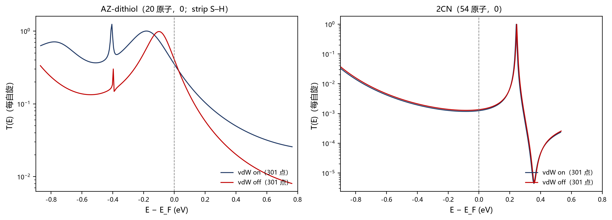

# vdW 开关整链输运对照（2026-11-22）

> 目的：在 light 档、同一生产协议、同一能量窗下，只切换 FHI-aims 的 TS-vdW 修正
> （`vdw_correction_hirshfeld` 开 / 关），把分子优化 → tip 弛豫 → 建结 → SCF → Aitranss
> → 分析整条链跑通，给出透射谱与热电器件量的差异。FHI-aims 的 TS 修正是**后自洽**的：
> 它只进入总能量与力，不改 KS 哈密顿量，因此同一几何下开/关 vdW 的 T(E) 完全相同；
> 这里量到的是**弛豫几何的响应**（分子优化 + tip 弛豫），不是固定几何的电子结构差。

## 1. 设计

| 项目 | 设置 |
|---|---|
| 体系 | AZ-dithiol（azulene-2,6-dithiol，C10H8S2，20 原子，charge 0，tip 阶段 strip S–H）；2CN（2CN-656-4-thiomethylphenyl，54 原子，charge 0） |
| 唯一变量 | `electrode.vdw`：true（Tkatchenko–Scheffler hirshfeld）/ false（无色散修正） |
| 电子结构 | FHI-aims 221103，PBE，spin none，species light，atomic_zora scalar |
| 分子优化 | BFGS，最大力 1e-2 eV/Å，sc_accuracy_forces 5e-3 eV/Å，sc_iter_limit 1000 |
| tip 弛豫 | Au–S 初距 2.35 Å，pin_contact=false，全原子 BFGS |
| 电极 | fcc111 37 Au/侧，nlayers=3，冻结 |
| SCF | rho 1e-5，eev 1e-3，etot 1e-6，sc_iter_limit 500，KS_method serial |
| 输运 | Aitranss 071813，σ=0.05/0.10 Ha，能量窗 [−0.22, 0.0002, −0.16] Ha（301 点），T=300 K |
| 调度 | gpu-outside，8 CPU 任务/臂 |

vdW-on 基线复用 2026-11-22 light/tight 对照的 light 两臂（同协议、同 species、同能量窗）；
vdW-off 两臂在 `runs/vdw-2026-11-22/` 下新建。注意：两档的分子与 tip 几何都在各自设置下
重新优化，差异包含几何响应。

## 2. 结果

| 体系 | vdW | 总基函数 | 能量点 | E_F (Ha) | L0 (2e²/h) | S (µV/K) | κ_e (pW/K) | ZT | T(E_F) | max T |
|---|---|---:|---:|---:|---:|---:|---:|---:|---:|---:|
| AZ-dithiol（20 原子，0；strip S–H） | on | 4364 | 301 | -0.188093 | 0.373290 | +53.35 | 220.640 | 0.11194 | 0.342941 | 1.2406 |
| AZ-dithiol（20 原子，0；strip S–H） | off | 4364 | 301 | -0.188029 | 0.448504 | +71.08 | 226.230 | 0.23279 | 0.399619 | 0.9844 |
| 2CN（54 原子，0） | on | 4742 | 301 | -0.179492 | 0.001313 | -33.53 | 1.239 | 0.02769 | 0.001244 | 0.9997 |
| 2CN（54 原子，0） | off | 4742 | 301 | -0.179611 | 0.001418 | -30.27 | 1.280 | 0.02360 | 0.001346 | 0.9962 |

## 3. vdW-off 相对 on 的差值

| 体系 | ΔL0 | ΔS (µV/K) | Δκ_e | ΔZT | ΔT(E_F) |
|---|---:|---:|---:|---:|---:|
| AZ-dithiol（20 原子，0；strip S–H） | +20.1% | +17.72 | +2.5% | +108.0% | +16.5% |
| 2CN（54 原子，0） | +8.0% | +3.26 | +3.3% | -14.8% | +8.2% |

## 4. 透射谱

图中虚线为 E = E_F；纵轴为每自旋透射，对数坐标。

## 5. 结论与边界

- AZ-dithiol（20 原子，0；strip S–H）：L0 0.373290 → 0.448504（+20.1%），S +53.35 → +71.08 µV/K，κe 220.640 → 226.230 pW/K，ZT 0.11194 → 0.23279（+108.0%），T(E_F) 0.342941 → 0.399619。
- 2CN（54 原子，0）：L0 0.001313 → 0.001418（+8.0%），S -33.53 → -30.27 µV/K，κe 1.239 → 1.280 pW/K，ZT 0.02769 → 0.02360（-14.8%），T(E_F) 0.001244 → 0.001346。

- TS-vdW 的作用路径是弛豫几何：本次 on/off 的 S–Au 接触距离只差 0.002–0.007 Å
  （AZ 2.251/2.244 Å，2CN 2.425/2.427 Å），但 E_F 附近的谱形对亚 0.01 Å 的构型差也已敏感，
  因此两体系的方向/幅度不同，不能外推成“vdW 一定使 ZT 升高/降低”。
- 边界：两个体系、一个能量窗、300 K、每臂一次；没有做 vdW 参数（TS vs MBD）、电极层数、
  泛函或 k 点的收敛对照；两档几何各自优化，差异来自几何响应而非固定几何的哈密顿量改变。
- 复现：`pwsh .tmp/vdw_report.py` 读取各臂 results.json / TE.dat / aims.out 生成本报告。

*生成时间：自动脚本；数据目录 `runs/light-tight-2026-11-22/`（on）与 `runs/vdw-2026-11-22/`（off）。*
